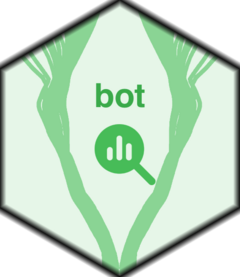

<!-- README.md is generated from README.qmd. Please edit that file -->

# bot <a href="https://tractoverse.github.io/bot/"></a>

<!-- badges: start -->

[](https://github.com/tractoverse/bot/actions/workflows/R-CMD-check.yaml)
[](https://app.codecov.io/gh/tractoverse/bot)
[](https://github.com/tractoverse/bot/actions/workflows/pkgdown.yaml)
<!-- badges: end -->

The goal of [**bot**](https://tractoverse.github.io/bot/) (**B**undle
**O**ptimal **T**ransport) is to implement statistical methods for
diffusion MRI tractography data, centered on optimal transport between
[`fiber`](https://tractoverse.github.io/fiber/) bundles.

**bot** is one member of the
[tractoverse](https://tractoverse.github.io/) family of packages.

## Installation

You can install the development version of bot from
[GitHub](https://github.com/) with:

``` r
# install.packages("remotes")
remotes::install_github("tractoverse/bot")
```

## Status

**bot** is under active development (v0.0.0.9000) and does not yet
expose a stable API. The bundle optimal transport methods it will
implement are still being designed. Meanwhile, the slot for this role in
the [tractoverse](https://tractoverse.github.io/) family is reserved by
a placeholder export.
